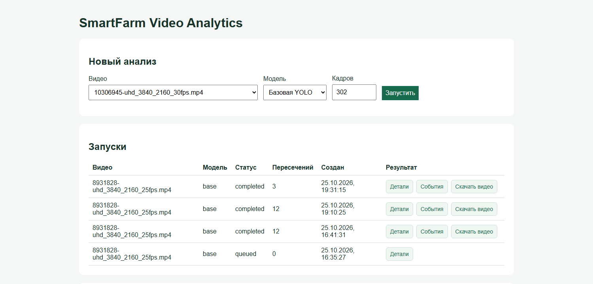
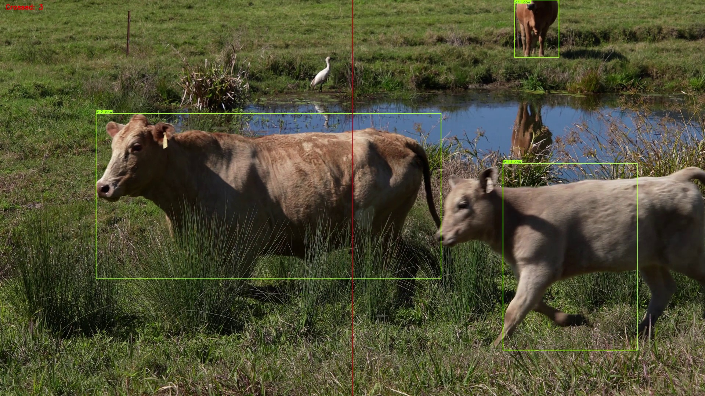

# SmartFarm Video Analytics

Локальный сервис видеоаналитики коров: YOLO11n обнаруживает животных на кадрах, ByteTrack связывает обнаружения между кадрами, а логика событий считает пересечения вертикальной линии справа налево. Результаты сохраняются в PostgreSQL и отображаются в веб-панели.

## Как выглядит

Веб-панель показывает доступные видео, запуски обработки и число событий:



Пример обработанного кадра: зелёные рамки и ID треков, красная линия подсчёта, число пересечений в левом верхнем углу.



Кадр взят из тестового видео Pexels № 8931828. [Лицензия Pexels](https://www.pexels.com/legal-pages/license/); исходное видео в репозиторий не включено.

```text
Видеофайл / RTSP → OpenCV → YOLO11n → ByteTrack → пересечение линии
                                                  ├─ PostgreSQL → FastAPI → панель
                                                  ├─ CSV с треками
                                                  └─ MP4 с рамками и ID
```

## Что работает

- Анализ локального видео и RTSP-потока через `run_video.py`.
- Базовая модель YOLO11n и выбор локальных дообученных весов v2/v3.
- События пересечения линии с номером кадра, временем и ID трека.
- Запуск обработки из веб-панели, статусы запусков, таблица событий и скачивание видео.
- PostgreSQL в Docker Compose. Для проверки RTSP можно отдельно запустить MediaMTX с зацикленным видеофайлом.

ID выдаёт трекер в пределах одного запуска. Это не постоянный идентификатор животного. Подсчёт зависит от качества детекции и устойчивости трека: перекрытия животных и ложные рамки могут привести к пропущенным или лишним событиям.

## Быстрый запуск на Windows

Проверенная конфигурация: Python 3.11, NVIDIA RTX 4060 Laptop GPU, Docker Desktop. Обработка и API работают в Python на хосте; контейнер нужен для PostgreSQL. Для записи H.264-видео используется OpenCV с Windows Media Foundation.

1. Создайте окружение Python и установите зависимости из `requirements.txt`. PyTorch с поддержкой нужной версии CUDA установите согласно инструкции для вашей видеокарты.
2. Скопируйте `.env.example` в `.env` и задайте пароль `SMARTFARM_DB_PASSWORD`.
3. Положите собственное видео `.mp4` или `.webm` в папку `data/`.
4. Положите базовые веса `yolo11n.pt` в корень проекта. Дообученные веса необязательны; пути к ним заданы в `run_video.py`. Веса и видео исключены из Git.
5. Запустите базу и API:

```powershell
docker compose up -d db
python api.py
```

Откройте `http://127.0.0.1:8000`, выберите видео и базовую YOLO, затем нажмите «Запустить». Состояние запуска появится в таблице. Для завершённого запуска доступны события и обработанное видео. Документация API: `http://127.0.0.1:8000/docs`.

При первом создании тома PostgreSQL файл `db/init.sql` создаёт таблицы. Если том существовал до добавления `analysis_runs`, примените `db/002_analysis_runs.sql` к существующей базе.

## Запуск из командной строки

```powershell
python run_video.py --source "data/your-video.mp4" --name demo --weights base --max-frames 300
```

Результаты будут в `outputs/demo_tracking.mp4` и `outputs/demo_tracks.csv`; события — в PostgreSQL. Параметр `--name` задаёт имя результатов. `--weights` принимает `base`, `v2` или `v3`; для последних двух нужны локальные файлы `best.pt` по путям из `run_video.py`.

Для RTSP используется тот же скрипт с адресом вида `rtsp://127.0.0.1:8554/cows`. Необязательный сервис `rtsp` в `compose.yaml` читает файл `data/mixkit-cows-walking-trough-a-road-7429-hd-ready.mp4`; для его запуска нужно отдельно получить этот файл или изменить путь к своему видео в Compose.

## Обучение и проверка

В ходе проекта размечены кадры в CVAT и проведены эксперименты с дообучением на небольшом наборе изображений. `train.py` показывает параметры последнего эксперимента. Датасеты, исходные видео, результаты и веса не входят в репозиторий: `data/` и `outputs/` исключены через `.gitignore`.

На отдельном ролике, по ручному подсчёту, линию пересекли 13 животных. Базовая модель дала 12 событий, а одна из дообученных версий тоже 12, но с другим набором ошибок. Это проверка конкретного видео, не оценка точности на репрезентативной выборке. Для воспроизводимой количественной оценки потребуется отдельный размеченный тестовый набор.

## Структура проекта

| Путь | Назначение |
| --- | --- |
| `run_video.py` | Детекция, трекинг, подсчёт и запись результатов |
| `api.py`, `dashboard.html` | API и веб-панель |
| `db/`, `compose.yaml` | Схема PostgreSQL и локальные сервисы |
| `mediamtx.yml` | Тестовый RTSP-поток |
| `train.py`, `prepare_road_dataset.py`, `compare_models.py` | Эксперименты с датасетом и моделями |
| `archive/lessons/` | Учебные скрипты ранних этапов |

Сервис рассчитан на локальный запуск и демонстрацию. Обработка выполняется фоновым заданием внутри процесса FastAPI: если процесс остановится, незавершённое задание автоматически не возобновится.
